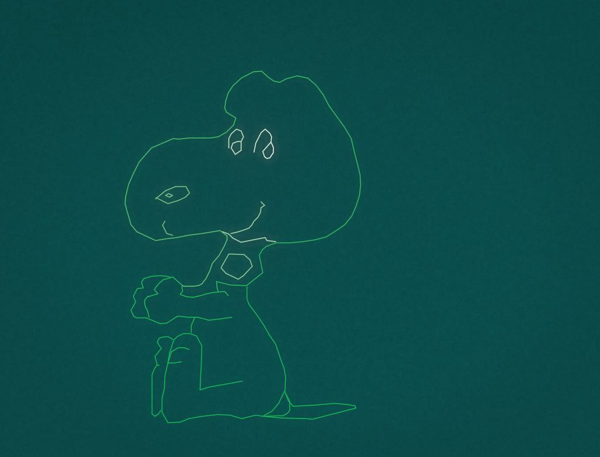

# tek-tube

A Tektronix 4010/4014 **direct-view bistable storage tube** display emulator in
Rust.  It plays back the plot files that 1970s mainframe and minicomputer
graphics packages (PLOT10, DISSPLA, ICEMDDN, ...) pushed down a serial line to
a Tek terminal - the files shown in
[Tektronix 4052 Vector Graphics Computer - PLOT10 Demo](https://www.youtube.com/watch?v=2SbCIP1m6hs).

What makes the picture look like the real thing is the tube model, not the
line drawing: a vector is stroked with a hot write beam that flashes *almost
white green* and then settles into the *medium acid green* stored image that
stays on the flood-gun lit target until the whole screen is erased.




Measured on a stroke, by `--probe`: `#E6FFF4` while the write beam is still on
it (hot, almost white) and `#0EBD59` once it has settled into the stored image
(medium acid green).  Both frames above are the same file: the first is a
frame from `--png-seq` while the beam is still racing around the picture (the
face was drawn last and is still hot), the second is the same file after the
flash has settled.

More renders in `docs/`: `dissspla.png` (the DISSPLA demo from the video),
`gplanet.png`, `wizard.png`, `usmap.png`, `spock.png` (4014 grayscale point
plot), `spacelab.png` (ICEMDDN CAD, matches the reference render),
`ic-mandala.png`.

## What is emulated

**The protocol** (`src/protocol.rs`)

* alpha (text) mode, `GS` graph mode, `FS` point plot, `ESC FS` special point
  plot with per-point intensity/focus, `RS` incremental plot
* coordinates transmitted high-Y, low-Y, high-X, low-X, 5 bits per character,
  with the byte ranges (`0x20..0x3F`, `0x40..0x5F`, `0x60..0x7F`) telling the
  terminal which field arrived, so unchanged fields may be omitted
* Enhanced Graphics Module 12 bit addressing: the extra byte between high-Y
  and low-Y adds quarter-dot resolution (4096x3120 target on the 4014, versus
  1024x780 visible on the 4010)
* escape set: form feed (erase), the four font sizes (`ESC 8`, `9`, `:`, `;`),
  the 3x8 line-style/mode table (`ESC \`` .. `ESC w`) for solid, dotted,
  dash-dot, short and long dashes, defocussed writing and non-storing
  write-through ("dark mode") drawing, ANSI CSI/OSC swallowing

**The tube** (`src/tube.rs`)

* three light producing populations per addressable spot: `stored` (bistable
  charge - the image that remains), `fresh` (the write beam's flash, decaying
  with a ~0.45 s time constant) and `under` (write-through vectors, which are
  never stored and therefore vanish unless the host keeps refreshing them).
  All three are emitted *light*, and the whole chain is linear until the last
  step: the populations are summed as light, halation is added there, the flood
  gun's glow is summed in, and only then is the display transfer
  (`light^(1/2.2)`) applied per channel.  Scattering and averaging therefore
  happen in light, not in display bytes
* **chromaticity lives in linear light**: each emitter has a fixed linear
  red:green:blue ratio and the transfer's exponent turns it into the ratio a
  camera records.  That is why the stored image (about 0.002:1:0.06 in light)
  reads as blue/green 0.47 on screen while the flood gun's much bluer glow
  (0.011:1:0.95) reads as 0.98.  The two emitters genuinely have different
  linear colours, and a single "phosphor colour" cannot produce both - the
  stored stroke is markedly *greener* than the field it sits on
* **the flood gun**, which is what an unwritten storage target actually looks
  like: not black but a dark, uneven green field.  `flood_field()` is two fine
  octaves of value noise (cells of 6 and 2 dots, not clouds), a slow gradient,
  a radial shelf, per pixel grain and sparse specks, and `ambient_at()` scales
  it by the measured level.  The gradient, the shelf, the grain and the speck
  rate come from photographs of real hardware.  The field is *quiet*: a blank
  target varies by about 4 % in total, and only ~1 % of that is at 8 to 16 dot
  blocks.  Earlier cells of 8 and 18 dots gave three times the measured coarse
  contrast, which read as blotchy clouds.  `docs/field-texture.png` puts the
  flattest patch of the model's field next to the flattest patch of the museum
  photograph at the same physical scale, as displayed and with the contrast
  stretched 10x so the texture is visible at all:

  | flat patch | total std | 2 dot | 4 dot | 8 dot | 16 dot | per-pixel |
  |---|---|---|---|---|---|---|
  | tek-tube | 2.2 % | 1.5 % | 1.2 % | 0.9 % | 0.6 % | 1.8 % |
  | museum photo | 2.1 % | 1.5 % | 1.1 % | 0.6 % | 0.3 % | 1.8 % |
* **halation**: light scattering through phosphor and glass, as five summed
  scales - 0.12 at 5 dots, 0.05 at 24, 0.03 at 90, 0.012 at 220, 0.006 at 420
  - approximating the measured, heavy tailed falloff of about 5 % / 1.7 % /
  0.9 % / 0.3 % of a stroke's light at 5 / 37 / 70 / 98 dots.  The radii are
  quoted in **4010 dots**, i.e. as a physical distance on the face, so the halo
  comes out the same size on a 4010 target and on a 4014 one.  Each weight is
  the fraction of the source light that scale contributes *to a convolution*,
  so its local effect depends on how dense the source is: an isolated stroke
  only picks up a few percent of its own light, while a filled region picks up
  most of the 0.22 sum.  Because every scale is far wider than it is detailed,
  the whole sum is evaluated on one half resolution grid - one down-sample, a
  sliding window box blur per scale, one up-sample - which is
  photometrically identical to five full resolution convolutions (max 8 of 255
  on 0.04 % of pixels) at a quarter of the cost
* the beam is a Gaussian current density and every stroke deposits *coverage*
  (`exp(-d^2/2 sigma^2)` for the distance to the stroke, evaluated over the
  scan lines it can touch) rather than lighting whole pixels.  This is what
  makes it a vector display: no staircase on diagonals, no dot-quantising of
  thin lines, sub-dot stroke positions are honoured, and glyph outlines are
  stroked as curves.  Line weight is `--beam` (default 0.5, a fine glowing
  hairline; 0.8 is heavier)
* the flash appears because the beam's own emission is summed on top of the
  charge it deposits: a just written stroke carries 0.44 of stored light plus
  0.56 of beam light, which lands at full scale - white - and fades to the
  stored green with the `--glow` time constant.  `--sat`, `--store-gain` and
  `--fresh-gain` expose the constants
* `advance()` feeds the serial input in ~16 sub-steps per interval and ages the
  phosphor *between* them, so a stroke written early in a frame has cooled by
  the time the frame ends while one written at the end of the frame is still
  hot.  (Feeding the whole batch and then ageing it by the whole interval made
  every stroke in the batch share the age of the last one, which wiped out the
  beam's trail at any frame rate below ~1000 fps)
* `decay()` costs one multiply: the transient populations are stored at a scale
  factor and it is the *scale* that decays exponentially.  Sweeping a megapixel
  array for every sub-step would otherwise dominate the runtime
* defocussed writing (ESC h..o) widens the profile and drops the peak
  accordingly, dashes are cut along the length of the stroke, point plot
  honours the 4014 intensity table

**Text** is drawn as stroked vectors through the same beam and phosphor model
(the real terminal had no character ROM in the beam path), using the
public-domain Hershey fonts (see `NOTICE.md`).

## Against real hardware

The model is calibrated against photographs of real terminals, not against
other emulators.

`docs/compare-real-photo.png` is a three panel figure: a museum 4010-1
photographed while running this very DISSPLA demo (`isco14.plt`), the same file
in this emulator, and the difference.  The two are aligned by scaling the
emulator's drawing to the photo's drawing, because the photo's crop rectangle
includes the CRT's mounting, not just the addressable area:

| | real 4010-1 (photo) | tek-tube |
|---|---|---|
| blank target (median) | `#0D4C49` | `#0A4B4A` |
| stored stroke | `#00AE54` (0,174,84) typical, brightest 241 | `#0EBD59` (14,189,89), brightest 198 |
| stroke blue/green, red/green | 0.48, 0.00 (red clipped in the photo) | 0.47, 0.07 |
| field blue/green, red/green | 0.96, 0.17 | 0.99, 0.13 |
| field / stroke, display value | 0.44 | 0.40 |
| whole-screen mean green | 93.7 | 88.4 |
| aligned mean green | 112.4 | 97.5 |
| aligned stroke colour over green 150 | `#00B255` | `#0DA254` |
| aligned fraction of dots over green 120 / 150 / 180 | 0.371 / 0.272 / 0.122 | 0.206 / 0.070 / 0.035 |

So the levels agree to within a few percent - the blank target, the stored
stroke, the field-to-stroke ratio and the hue of both emitters - and the
emulator draws the same picture in the same place.  What does not agree is the
*area* of stroke: the photo has two to three times as many bright dots.

That gap is in the capture, not something this model should copy.  The
museum photo is a hand held shot of a CRT: 1 addressable dot is about 0.31
photo pixels, a real 4010's focused spot is about 1.6 dots, and yet the
strokes in that photo are several pixels wide with the same peak level as an
unblurred stroke.  The tube's own halation is additive - it puts a few percent
of a stroke's light into the surrounding few dots, which is what the model
does - so the wide, bright strokes in the picture are the camera's lens, the
glass and the file's compression, not the tube.  Fitting the model until it
reproduced them is where an earlier version of this project went wrong: it
grew a "camera" stage whose constants were fitted through two implementation
bugs (halation was applied twice, and its radii were divided by the target's
dot scale), so the emulator needed more and more fake blur to reach the
recording.  Both bugs are fixed, the halo is now the size the hardware
measurements say, and `--camera` is explicitly a *lens* post-process, not part
of the tube.

`docs/compare-video-gplanet.png` has three panels: a frame of the source 4052
recording, the same file in the emulator, and the emulator through the lens
model.  Alignment is by the graphics bounding box.  The recording's file names
are printed above its graphics area by the author's program, which is how
`gplanet.plt` (byte-identical to `samples/16_gplanet.plt`), `isco14.plt` and
`bugss45.plt` were identified.

| | recording | device model | + lens model |
|---|---|---|---|
| mean green | 90.3 | 91.2 | 43.9 |
| dots over green 120 | 0.351 | 0.292 | 0.120 |
| dots over green 180 | 0.225 | 0.035 | 0.015 |

`docs/compare-video-detail.png` zooms into one region of `gplanet.plt`: the
recording mid-draw and stored on the left, the device model at the same point
of the plot and then settled on the right.  The model's mid-draw panel is the
clearest view of the write beam's trail - strokes enter white-hot and cool to
the stored green behind the beam.

`docs/compare-video-isco14.png` is the same three-way comparison for the
complete `isco14.plt` frame (recording, device model, lens model).  The fade
figures show the flash decaying while a file is still being drawn:
`fade-in-progress.png` and `fade-half-drawn-map.png` freeze a partly drawn
file with a live beam, `fade-sequence.png` tiles six successive frames of the
same file, and `fade-detail-2x.png` magnifies a stroke of it.  The flood gun
field itself is easiest to see in `reference-real-4010.jpg`
(`ref/tek4010_screen.jpg` in the parent directory is the photograph the
measurements in the table above come from).

The *device* model lands on the recording's overall level and keeps the
drawing's structure, including the merging of crowded strokes.  The recording
still has far more saturated dots, and its background is black where the
tube's is a lit green: that is the phone camera's contrast crush, which the
lens model reproduces.  That model is a *lens* - its contrast curve was fitted
to the previous, mis-scaled device pipeline and has not been recalibrated, so
it now comes out about twice too dark; treat it as a diagnostic, not as part
of the tube.

## Build and run

```sh
cargo build --release          # binary in target/release/tek-tube
cargo test                     # 21 unit and end-to-end tests
```

Play a file in a window (ESC or the close button quits):

```sh
tek-tube samples/05_snoopy.plt                  # 19200 baud, live drawing
tek-tube --baud 2400 samples/16_gplanet.plt     # slower line, longer flash
tek-tube --device 4010 samples/test.plt         # 11 inch 4010 instead of 4014
```

Draw to a PNG instead of a window, watching the flash settle:

```sh
tek-tube samples/05_snoopy.plt --png snoopy.png --baud 0 --settle 2.0
tek-tube samples/05_snoopy.plt --png-seq frames/f --frames 12 --frame-dt 0.4 --baud 2400
```

`--png` runs the whole file instantly and then ages the phosphor by `--settle`
seconds, so the result is what the terminal would show a moment later.
`--png-at SECONDS` freezes the drawing at an exact point of the playback
(stepping internally at 120 Hz), which is how the half drawn frames with a live
write-beam flash are made.  `--png-seq` writes numbered frames as the file
plays.

**The window** is the render, one buffer pixel per screen pixel: the process
declares per monitor DPI awareness, so a 1024x780 buffer occupies 1024x780
*physical* pixels at any scaling.  Without that declaration Windows stretches
the window by the monitor's scale factor - on a 150 % display the same buffer is
bilinearly blown up to 1536x1170 before it is shown - which turns the strokes
and every speck of phosphor grain into fog.  A settled target is not recomposed
at all, so an idle screen costs nothing and runs at the display's rate; while a
file is being drawn, one frame costs about 16 ms at 1024x780 in a release build
and about 71 ms in the debug one.

Everything except the target scan scales with the *output* pixels, so a finer
window is proportionally slower.  Measured through `render_into` on 2026-10-03,
flood field warm, best of five, the same code both ways:

| `--shrink` | window | release | debug |
|---|---|---|---|
| 4 (default) | 1024x780 | 16.0 ms | 71.4 ms |
| 2 | 2048x1560 | 32.1 ms | 191.4 ms |
| 1 | 4096x3120 | 114.3 ms | 708.0 ms |

The 38 / 164 / 974 ms this table carried before 2026-10-03 could not be
reproduced in either profile here, so they are replaced rather than relabelled.

`--shrink 2` and `--shrink 1` are still for `--png`/`--png-seq` output rather
than for a live window - the live window is sharp because it is pixel exact, not
because it is large - but in release `--shrink 2` is no longer a slideshow.

**Fullscreen is the default** - borderless (`WS_POPUP`, no caption, no frame) -
and **F11 toggles it** while running; `--windowed` starts in a titled frame
instead.  A window cannot change its own decorations, so F11 rebuilds the window
rather than restyling it, and the shell and the tube simply carry on: nothing is
lost but the image, which the pen redraws (see below).  ESC quits.

For a plot file the window is the whole primary monitor and the face is rendered
at the largest integer down-sample that fits the screen, then *centred without
any scaling* (`ScaleMode::Center`), so nothing is resampled and the rest of the
screen is black.  On a 2560x1440 screen that is `--shrink 3`, a 1365x1040 face.
The face is 4:3 and the screen is not, so filling it would mean either distorting
the face or scaling it up; scaling up is what made it look like fog, so the face
is left alone.  An explicit `--shrink` overrides the choice.

In terminal mode there is no such compromise, because there the tube *is* the
window: the page keeps the face's own 74x35 shape and the cell grows with the
window.  A 2560x1440 screen is a 93x32 page of 27x45 dot cells - the same
letters, more of them - and the stroke weight is derived from the cell the tube
is actually showing rather than from `--cell`, or the text would go spindly as
the window grew.

## Using it as a terminal

A 4010 *is* a terminal - it takes a byte stream and draws characters in alpha
mode and vectors in graph mode - so the stream can come from a pipe instead of a
file:

```sh
tek-tube - --device 4010 < plotfile      # or, on the other end of a pipe:
Get-Process | Format-Table | Out-String | tek-tube -
python tools/tekplot.py | tek-tube -
```

Line oriented shell output renders as it stands, columns intact, because a table
is only text and spaces: `docs/pipe-text.png` is
`Get-Process | Format-Table | Out-String` drawn straight onto the tube.

`tools/tekplot.py` is a worked example of the graphics side - ASCII text, then
`GS` and a 436 segment sine curve, then `CR` back to alpha mode for the caption
- which the tube draws as one stream (`docs/pipe-plot.png`).  Any program that
can write PLOT10 or 4010 protocol can drive it this way, and that is what the
hardware was bought for.

Driving a modern *interactive* shell is what does not work, for reasons that are
the hardware's rather than the emulator's:

* **VT positioning is discarded.**  `ESC[2J` (erase display), `ESC[H` (cursor
  home) and `ESC[5;10H` (position) are swallowed rather than interpreted, so text
  only ever flows onto the next line.  PSReadLine, progress bars and every full
  screen TUI redraw with cursor moves and come out wrong.  Colour escapes are
  swallowed too, which is the right answer for a monochrome green tube.
* **There is no keyboard path.**  A real 4010 sends keystrokes back up the line;
  this emulator has no input beyond ESC to quit.
* **A storage tube cannot scroll.**  Past its 35 row page the only thing to do is
  erase the whole screen (`--autoclear`, on by default), so a 60 line listing
  keeps only its last 25 lines - measured: 001-035 erased, 036-060 present.
  `--no-autoclear` clamps at the bottom row and overwrites it instead.
* **`-` reads to end of file before it draws**, so a long running producer shows
  nothing until it exits.

That is why these terminals were bought to plot with, not to type into.  Making
it interactive anyway is what `--shell` does - see `docs/terminal-mode.md` for
the design, the measured limits it has to work around, and what is reused.

### Terminal mode

`--shell CMD` runs a shell under a pseudoconsole and renders the session on the
tube instead of playing plot files:

```sh
tek-tube --shell powershell.exe --device 4010
```

The page advertised to the shell is **37x18** by default: cells at twice the
4010's own size, which is about 40 characters a line and as coarse as a shell
still reads well on this face.  `--cell 1` gives the 4010's own 74x35 (cells of
13.8 x 22.3 dots, a 0.62 aspect that suits the 4:3 face where an 80x24 grid
would be a tall thin 0.39).  Either way the page is the tube's, not the
terminal's invention.  Text is stroked through the same beam, halation and flood
field as everything else, so glyphs glow and settle exactly like vectors do.
`docs/terminal-session.png` is a real session replayed through the renderer,
`docs/terminal-live.png` is the live window, and `docs/font-compare.png` shows
the available faces at both sizes.

**The font is a stroke font, because it has to be.**  A storage tube stores
whatever the beam traces, and the 4010 stroked its characters rather than
scanning a character ROM - which is also why slow text on real hardware was
genuinely *written*.  The default is now Hershey Simplex **Monospaced**
(`futuram`): the same letterforms as the classic plotter face, but fixed pitch,
which is what a terminal is.  `--font simplex` gives the proportional original
and `--font gothic` the heavier face.

Two findings from comparing them:

* `--font gothic` (Hershey Gothic) is **not usable** as a terminal face at any
  size.  It is a *bold triplex outline* design - each stroke is drawn three
  times over - so at a terminal cell it fills in and collides, measuring about
  25 % more ink than the others.  It remains useful for plot-mode alpha text.
* The glyph scaler used to assume a 22-unit-wide glyph, which is true of Simplex
  and false of Gothic, so wide faces overflowed their cells.  It now scales by
  each font's own maximum width, so a wide face shrinks uniformly instead of
  colliding.

**The image cools from the flash to the stored green, never to nothing.**  With
the pen running the image used to fade all the way back to the background: the
commit condition refused to settle anything while the pen was busy, and a slow
pen is always busy, so nothing ever resolved.  A commit now *settles exactly
what the pen has drawn so far* rather than waiting for a full pass or drawing
ahead of it, so each letter cools to the stored level as it lands.

**Nothing is drawn twice.**  The stored image is what the pen has *drawn*,
never what the screen says now.  Taking the character from the screen put a glyph
into the image before the beam had reached it, and the beam then traced it again
over the top: that is the doubled drawing.  Measured on the live window at
`--write-rate 400`, after a `cls` followed by 400 lines of output - the shell
finished at t=0.06 s, and the old code was still writing the page at t=7.5 s,
filling it in from the top row down at about half a second a row while the
commits wiped the image back to whatever the pen had managed so far.  Content
appeared, vanished, and was drawn again over itself.

The other half of it is that a *wholesale* change is not something to trace at
all.  A scroll, a clear, an alt-screen switch or a resize changes every cell at
once; tracing a 37x18 page takes minutes at any rate slow enough to watch to be
worth watching, and a storage tube cannot scroll anyway - it can only be
rewritten.  The screen says when that has happened - a scroll, an erase of the
display, or an alt-screen switch sets a flag the renderer takes - and that signal
is the one that matters, because the share of changed cells does not catch them
on a sparse page: a listing scrolling past changes every *row* but only three or
four cells in each, which on a 93x32 page is a few per cent.  A quarter of the
cells changing remains as a backstop for anything else that redraws the page
without saying so.  Either way the pen's record is synced to the screen and the
next commit settles the whole page in one go; only incremental changes are
traced, which is what a pen is for.  Same measurement with the fix: the page is
complete and the beam idle within a frame of the shell going quiet.  The recorded
frames are in `cls3/` beside the source.

**Two prompts, and a page that outlived its erase.**  Two separate faults both
landed on the same symptom - a second `PS C:\Users\kevin>` after an `echo` or a
`cls` - and both were measured on the live window against this machine's
PowerShell before and after:

* **One press of Enter put three carriage returns on the wire.**  Windows
  reports a real key press twice: `WM_KEYDOWN` as a key event, the `WM_CHAR`
  translated from it as a character event, and a second `WM_CHAR` after the key
  is released.  Both paths translated the same key, so the shell ran the command
  plus *two empty ones*.  Measured: `echo hi` was followed by three prompts.
  The key event is the report that carries the modifiers, so the key path now
  owns every control key and the character path sends text only (`window_input`
  in `src/terminal.rs`), which is one prompt, and the two `WM_CHAR`s landing in
  different frames no longer matters.  The cost is a pasted line break, which
  arrives as a character with no key event - this is a terminal with no
  bracketed paste, and one doubled Enter per press is a worse trade than that.
* **A page replacement cleared the stored charge but not the beam's glow.**  A
  scroll, a clear or an alt screen switch replaces the image, and the previous
  page is still in the transient population, so it stayed lit for the whole
  trail: after a `cls` the old prompt and the erased tail of the old command
  line were still glowing under the new one (measured: 10 ghost cells, and the
  dumped stream showed the `echo hi` line's own cells at row 17).  `commit_to`
  now erases the transient with the stored image on a replacement - and only
  there: on the pen's own path the flash is the writing, cooling into the stored
  image.  Measured after: the only lit cell the screen does not have is the
  cursor.

**The frame is split across the cores where it can be.**  The render is a
per-pixel map plus separable blurs, and a fullscreen 2560x1440 tube is 3.7M
pixels a frame.  The splitter itself measures **5.5x on 8 threads** (37.8 ms ->
6.9 ms for a 2560x1440 row pass), and that number is asserted by
`the_split_uses_more_than_one_thread`, which is the test that would catch a
splitter quietly running everything on one thread.  What is split is every pass
that writes a row at a time: the transfer, the colour pass, the halation's
down-sample, its up-sample, and the horizontal half of each box blur.  The split
is bit for bit what the serial code produced - a row of the destination is only
written from its own rows of the source, so no sum is reordered - which
`splitting_a_pass_does_not_change_a_single_value` holds to.

**The vertical half was the hold-out, and is now split too.**  Its running sum
goes *down* a column, so its unit of work is a column, and one thread's writes
would interleave with the next's `w` elements apart - which is exactly what the
borrow checker will not express.  Rather than reach for `unsafe`, the column
results are copied into a buffer laid out the other way round, which turns the
pass into two passes over independent rows, both of which `par_rows` splits.  It
costs one more buffer and one more read of the data, and it takes off one core the
half that was 28% of the frame.

Measured on the running terminal - debug build, 1024x780, from the exit summary -
173 frames at **51.4 ms each, 19 fps while drawing**: against 89.6 ms windowed
before the vertical split and 245.7 ms before any of it.  The same windowed
summary in the release build on 2026-10-03: **46 frames at 17.3 ms each, 58 fps
while drawing**, three times the debug rate and in the profile this work was for.

**Tried, measured and rejected twice: blocking the vertical pass.**  The step
that follows from the memory story is to stop walking a row-major buffer with a
stride at all - give each thread a *run* of columns, rows outer, so every cache
line is consumed whole.  First measured in the debug build: blocked 16 columns by
32 rows, **77.7 ms a frame against 49.4 ms**, a 57% *regression*, because the
per-element cost of the blocked loops (array indexing, iterator machinery) dwarfs
the cache effect they buy.  The reading at the time was that a release build
would show the opposite, and a release build was exactly what this machine would
not produce.

It can now (see the note at the end), and the prediction does not hold.  The same
idea, rebuilt and measured 2026-10-03, bit for bit the same output at every
setting, tile widths of 8, 16, 32 and 64 columns, at the real render's grid sizes
and radii:

| halation grid | split | blocked, best tile | |
|---|---|---|---|
| 512x390 (terminal 1024x780) | 3.38 ms | 3.33 ms (16) | 1.01x |
| 683x520 (plot `--shrink 3`) | 3.56 ms | 3.59 ms (64) | 0.99x |
| 1280x720 (terminal 2560x1440) | 5.01 ms | 5.06 ms (16) | 0.99x |

and the whole frame through `render_into`, split against blocked at `--shrink`
4 / 2 / 1: **15.97 / 32.08 / 114.25 ms against 16.25 / 33.44 / 110.92 ms**.  No
tile width wins anywhere, and the one number that favours blocking is 3%, at the
one shape that is stills-only.  The debug build loses with the same code by the
same margin as the original attempt (0.74x to 0.80x), so what fails is the idea,
not one implementation of it.

Why the paper analysis does not bite: the walk's read amplification is real, but
the halation grid is 3.7 MB at 1280x720 and 12.8 MB at 2048x1560, and this
machine's last level cache is 36 MB, so the stride mostly hits L3 rather than the
memory system the argument was about.  The change is not shipped, and the
question is closed: this is no longer "the first thing to try if a release build
ever appears".

The terminal's exit summary reports the frame rate it actually achieved, so "is it
smooth" is a measurement rather than an impression.

**Letter spacing.**  A plotter font has a huge width range - in Hershey Mono
`i` is 2 units, `W` is 20 and `@` is 28 - and since every glyph shares one
scale, the widest one set it and every ordinary letter sat filling half its
cell.  The gap is `1 - 0.95 * W / W_max`, so it is fixed by the font's range
alone and *no* page geometry or scaling can close it.  The fix is to narrow the
range: glyphs wider than 70 % of the widest are condensed to that cap (narrow
ones are never stretched), and the fit is computed from the cap.  Measured at
the default size: `H` went from 13 px of ink in a 27 px cell to 18 px, so its gap
closed from 14 px to 9 px, `W` from 9 px to 5 px, and the cap height grew from 19
to 27 px - closer letters and bigger text for free, with the pitch still exactly
one cell.  `docs/gap-compare.png` is before and after.  Glyphs also fill 85 % of
the cell height and 95 % of its width; those two numbers are what set the gaps.

**Stroke weight.**  A beam is measured in 4010 dots, which says nothing about
how large a glyph is - so doubling the cell size halved the stroke weight
relative to the glyph and the text went spindly (measured: at the doubled size
only 68 pixels of the page reached full ink, against 4,216 once fixed, because
most stroke cores fell below the display threshold entirely).  Terminal mode now
scales the beam by the cell, and then by 1.5, because a terminal glyph is far
smaller than the lettering inside a plot file and at a hairline weight it reads
as too light next to one.  `docs/beam-compare.png` is the before and after.
`--beam` still scales it if you want heavier or finer.

An OCR-A-style stroke face was prototyped (five glyphs, hand-authored, rendered
at the new default size: `docs/font-ocra-probe.png`) to judge whether the
letterforms are worth chasing.  The mechanism works - hand-authored strokes draw
through the tube like any other font - but a first pass without iteration is
visibly crude, and it has to be normalised to the same cap height and cell width
as the rest or it comes out 40 % oversized, as that probe did.  It is not
shipped; the probe was removed rather than left as a half-font that draws
nothing for most characters.

**The image works the way a storage tube forces it to.**  A storage tube cannot
erase one character, so content that is still moving is written into the
transient population only: it flashes hot and decays, and because each frame
lands on the previous frame's decaying glow, anything that moved leaves a trail.
When the screen has been quiet for 0.3 s the current screen is *committed*: the
stored image is erased and the screen is re-stroked into it without lighting the
beam, so the smear **resolves** to a crisp stored image.  The commit replaces
rather than merges, which is what stops scrolled-away text from ghosting for
ever.  `--trail F` sets how long the transient lingers: a plot file's default is
0.3 s and the terminal's is 1.1 s, a quick cool from the near-white flash to the
stored acid green that settles the hue in well under a second; `--trail 0` is a
plain storage tube with no smear at all, and longer values leave the writing
visibly fading for a second, which reads as slow and steps visibly at any
window's frame rate.

* **Ctrl+Shift+Q** quits, or just exit the shell.  ESC has to reach the shell,
  so it can no longer be the quit key, and **F11** - which the shell has no use
  for - toggles fullscreen.  Both are consumed by the window and never reach the
  shell.
* Keys without a character are translated to VT sequences (arrows, F1-F12,
  Home/End/PgUp/PgDn, Insert/Delete, Ctrl+letter); printable text goes through
  minifb's Unicode input, so keyboard layout and AltGr are handled for you.
  Control characters come from the **key** path only - the character path's copy
  of them was the doubled Enter described above.
* `CSI 6n` - the console host asking where the cursor is - is answered from the
  screen's real cursor position.  Answering it with a fixed value lets the
  session run but corrupts PSReadLine's redraw into overlapping text.
* `--vt-replay FILE --png OUT` renders a captured stream, which is how the
  renderer is checked without a window.
* `TEK_DUMP=path` writes everything the shell sends to `path`.  Replaying a dump
  is what settles "is this the parser or the live path?": if the page comes out
  right from the bytes, the fault is in the live drawing, not the parse.  That is
  how the duplicated-prompt-after-F11 fault was found - and how the pen was
  cleared of it.

* **`--write-rate DOTS`** is how fast the beam draws, in target dots per second,
  and it is **on by default at 2500**: a letter is about 60 dots, so that is
  about 42 letters a second, and `--write-rate 0` draws the page instantly as it
  always did.  The pen walks the page in reading order and traces only cells
  whose character has changed, so typing one letter traces one letter.
  The number is calibrated against the thing it sits beside, measured from the
  sample files: a plot file's beam sweeps at **4,587 to 15,193 of the 4010's
  dots per second** at the default 19,200 baud (11,096 for `05_snoopy`, 15,193
  for `09_wizard`, 5,129 for `16_gplanet`), and at 401 dots/s on a point plot,
  which turns every byte into a dot rather than a stroke.  4000 is ten times the
  400 the pen was being run at and sits inside that band; `--stats` now prints
  the figure for whatever stream is played, so the two can be compared directly.
  A scroll, a clear or a resize is *replaced* rather than traced (see above), and
  the image is settled from what the pen has drawn - never from what the screen
  says now.
* **Resizing** the window adds or removes whole cells: the page is recomputed
  from the window size at the same cell ratio, the tube is rebuilt to match, and
  the shell is told, so nothing is stretched.  The visible page is then *blanked*,
  because the screen model keeps no reflow: the shell works out which line it is
  on from the geometry it has been given and repaints its whole buffer, so leaving
  the old rows in place made that repaint land *beside* them.  Measured: an F11
  with a command on screen produced the block of output twice and a
  half-overwritten prompt.  The old lines are still in the scrollback.
* **Scrollback**: Shift+PageUp / Shift+PageDown or the mouse wheel read back
  through the lines that have scrolled off, and the window title says how far
  back you are.  Any new output returns to the live page.  A full clear drops the
  history, as the hardware's erase does.
* **The alternate screen** works, so full-screen programs get a page of their
  own; the trail is shortened to 0.25 s while one is active, since a program that
  repaints every cell would otherwise smear into mud.

The stroke font is ASCII, so a character the font has no glyph for draws as
`?` rather than silently vanishing.  Until 2026-10-02 the *release* build on this
machine was subject to the Smart App Control lottery described below; Smart App
Control is now off and a release build runs, so the trail can be judged in the
profile it was tuned for.  (The debug build renders about four times slower, and
its trail therefore decays about four times slower in wall clock terms, which
makes it look heavier than it is.)

Useful verification flags:

```sh
tek-tube samples/isco10.plt --png out.png --stats --dump-chars --probe 1600,1500
```

* `--stats` prints what was decoded (`N vectors, N points, N characters`,
  stray bytes, address range, whether 12 bit addressing was used)
* `--dump-chars` prints every alpha character with the cell it was drawn into
* `--probe X,Y` prints the colour of one target dot, e.g. `#0EBD59` for a
  settled stored stroke

Full option list: `tek-tube --help`.

## Targets

| device | addressable | visible | notes |
|---|---|---|---|
| `--device 4014` (default) | 4096x4096 | 4096x3120 | Enhanced Graphics Module, 12 bit, quarter dot precision |
| `--device 4010` | 1024x1024 | 1024x780 | 10 bit, the extra bits are ignored as on an un-enhanced terminal |

The 4014 target is a superset: a 4010 file's 10 bit coordinate maps to the same
physical spot (x4 with the two extra bits clear), so the default renders either
kind of file at the finer resolution.  Output area-averages the emitted light
down (`--shrink`, default 4 for the 4014) so the picture is 1024x780 whatever
the target, and can be magnified with `--zoom`.

## Verification

`cargo test` covers: the coordinate encoding from the real manual example
`(23,142)` = `$n W`, field omission, quad-dot addressing with the extra byte on
the 4014 and its absence on the 4010, alpha layout/cell sizes, form feed,
the line style/mode escape table, point plot and special point plot with the
4014 intensity table, incremental plot, glyph baseline/cap-height/descender
geometry from the Hershey data, the tube's flash-to-stored fade (hot almost
white -> saturated acid green -> unchanged after any further wait), erase,
write-through decay, dashing, anti-aliasing (monotone soft edge profile next to
a diagonal stroke, and a stroke placed between two dots lighting both of them
equally), output row orientation, the flood gun's field shape, and an
end-to-end test that decodes `samples/05_snoopy.plt` and requires the outline
to land inside its address range and leave green stored charge behind.

Two of those tests exist because the model got them wrong: one requires that a
stroke written at the end of a frame is hotter than one written at the start of
it (`advance` ageing a whole batch at once fails it), and one requires that the
halo past a straight edge comes out the same number of output pixels on a 4010
and on a 4014 (dividing the radii by the target's scale factor fails it).

Renders were also compared against the reference render of the same file
shipped with the Tek4010 emulator (`samples/icemddn_spacelab.png`): the
orientation/overlap metric is highest for an unrotated match, which caught an
upside-down output bug during development.

## Sample plot files

`samples/` holds demo files used for testing, collected by Chuck Forsberg and
redistributed by the
[rricharz/Tek4010](https://github.com/rricharz/Tek4010) project in its
`pltfiles/` directory.  That collection is **not** under the GPL of that
project and is meant for personal use; the files here are test inputs only and
are not covered by this project's licence.  `icemddn_spacelab.png` is the
reference render of `icemddn_spacelab.plt` from the same directory.

Files that map onto the video: `05_snoopy.plt` (Snoopy and the Red Baron),
`16_gplanet.plt` (G Planet, from the 4014 program manager's demo tape),
`drawing.plt` and `icemddn_spacelab.plt` (ICEMDDN CAD), `isco10.plt` (DISSPLA
demo), `13_bugss14.plt`, `bugss45.plt` (montages), `09_wizard.plt` (the Tek
wizard), `07_usmap.plt`, `test.plt` (bar chart), `animation.plt`,
`spock.plt` (4014 grayscale point plot).

## Environment note: Smart App Control (release binaries were blocked until 2026-10-02)

**Resolved: Smart App Control was turned off on 2026-10-02 and release builds
now run; the section below is kept as the record of what the block was and what
the retry loop cost.**  See the resolution at the end.

On this machine a freshly built release binary *was* refused with `os error 4551`
("An Application Control policy has blocked this file").  It is not a bug in the
program and it is not something a local code-signing trick can fix.  Diagnosed:

* Smart App Control is in **Enforcement**, as the Microsoft-signed WDAC base
  policy `VerifiedAndReputableDesktop`
  (`{0283AC0F-FFF1-49AE-ADA1-8A933130CAD6}`).
  `VerifiedAndReputablePolicyState` is `1` under
  `HKLM\SYSTEM\CurrentControlSet\Control\CI\Policy`, and
  `VerifiedAndReputablePolicyStateMinValueSeen` is `1` under `...\CI\Protected`.
  AppLocker is not involved (no deny events, no rules) and the machine is not
  enterprise managed (Windows 11 Home, not domain or Entra joined).
* The verdict is keyed on the file's **flat SHA-256**, so it is per *build*: the
  debug build's hash drew an allowing verdict and runs, three release hashes in
  a row drew blocking verdicts and stayed blocked, and copying or renaming a
  blocked binary changes nothing because the hash is the same.
* Event **3077** names the reason and it is the signing level, not a temporary
  cloud check: *"did not meet the **Enterprise signing level requirements** or
  violated code integrity policy (Policy ID `{0283ac0f-fff1-49ae-ada1-8a933130cad6}`)"*.
  So the honest reading of the lottery is that some unsigned builds happen to
  satisfy the policy's reputation path and most do not - and on 2026-10-02
  **nineteen fresh hashes in a row were refused**, release and debug, across six
  codegen flag sets, which is what makes the signing routes below the options
  worth actually considering rather than the retry loop.
* You can watch it happen, no admin needed:
  `Get-WinEvent -LogName Microsoft-Windows-CodeIntegrity/Operational |
  Where-Object Id -in 3077,3118 | Format-List`
  - event 3077 names the file and the policy, 3118 carries the hash and
  Defender's trust fields.

What actually changes the outcome:

* **Turn Smart App Control off** (Windows Security, requires elevation) - the
  route taken here on 2026-10-02.  Free and definite, but it is a machine-wide
  security change and Microsoft's docs disagree on whether it can be turned back
  on: the consumer FAQ now says yes, the developer doc still calls Off a one-way
  operation, and this machine carries the registry marker that gates
  re-enabling.  The Settings page did offer the choice, and the state change
  survived the restart (see the resolution below).
* **Sign every build with a certificate from a CA in the Microsoft Trusted Root
  Program** (Azure Artifact Signing from about $10/month, or a conventional
  OV/EV certificate, with an RFC3161 timestamp so an expired signature does not
  revert to unsigned).  This is the only option that keeps Smart App Control on
  and also makes a *distributed* build work.  A self-signed certificate does
  not: Smart App Control only considers certificates issued by trusted
  providers, so installing your own root leaves the file untrusted.
* **Rebuild and hope the new hash is allowed.**  Free, no security change,
  unreliable: measured here, 11 of 14 fresh hashes of the same program were
  allowed, but 3 of 3 release rebuilds were blocked.
* Defender exclusions cannot help (the block is a Code Integrity policy
  decision, not an antivirus one) and neither can an AppLocker rule (AppLocker
  is not the enforcing mechanism).

The debug build and the test binaries were never affected, so `cargo build` and
`cargo test` always worked; only the release binary was at the mercy of this.

### Resolution, 2026-10-02

Smart App Control was turned off (Windows Security, elevation required) and the
machine restarted.  The registry now reads `VerifiedAndReputablePolicyState = 0`
under `HKLM\SYSTEM\CurrentControlSet\Control\CI\Policy`, with `SAC_PreviousState
= 1` and `SAC_EnforcementReason = 6`, and
`VerifiedAndReputablePolicyStateMinValueSeen` under `...\CI\Protected` has fallen
from 1 to 0.  Since that boot the CodeIntegrity log holds no event 3077 at all -
nothing has been refused, only the periodic 3089/3033 policy heartbeats - and a
freshly built release binary runs: `cargo build --release`, a headless `--png`
render of `samples/isco10.plt`, a live `--shell` session, and `cargo test
--release` all work.  The nineteen-in-a-row refusals above are therefore the
recorded cost of the lottery, not a lasting property of the machine.

Nothing has been tested back the other way.  Microsoft's consumer FAQ says Smart
App Control can be turned on again, the developer doc still calls Off a one-way
operation, and this machine carries the marker that gates re-enabling; treat it
as one-way in practice.
